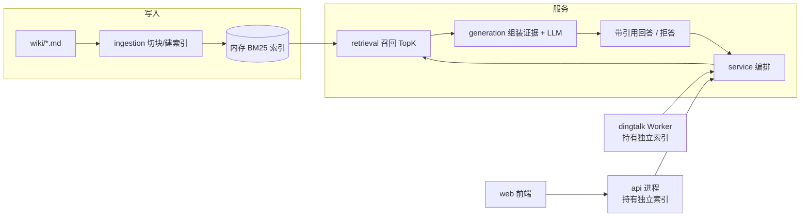

# 系统架构

## 分层结构
系统按 `ingestion → retrieval → generation → service → api/dingtalk/web` 五层组织：

- **ingestion**：读取 wiki 目录下的 Markdown，按一级至四级标题切块并提取标题路径，构建 BM25 全文索引。
- **retrieval**：接收查询，对索引打分并返回 Top-K 片段及其标题路径。
- **generation**：把片段与系统 Prompt 组装为上下文，调用大模型生成带引用的回答，约束“仅依据证据作答”，不足时拒答。
- **service**：编排索引生命周期、查询流程与会话管理，向上暴露统一接口。
- **api / dingtalk / web**：HTTP API、钉钉消息 Worker 与 Web 前端三个入口。

## 双进程模型
API 进程与钉钉 Worker 是两个独立进程，各自在启动时加载语料并持有**独立的内存索引**，互不共享运行时状态；因此语料变更后两者都需重新加载（或重启）才能生效。两进程只通过同一份磁盘语料与外部模型服务耦合，索引不落盘共享，避免引入检索服务依赖。

## 主要数据流
1. 写入流：`wiki/` 文件变更 → ingestion 切块与索引重建 → 内存索引更新。
2. 问答流：用户提问 → retrieval 召回 Top-K → generation 组装证据并调用 LLM → 返回带引用或拒答。
3. 入口流：Web/API 直连 service；钉钉消息经 Worker 转为同一查询请求。

